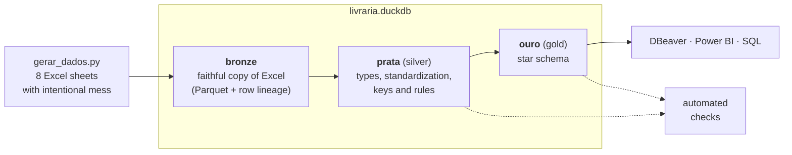
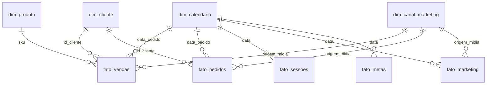

# Livraria Capítulo Um: e-commerce data pipeline with DuckDB

[🇧🇷 Português](README.md) · 🇺🇸 English

An end-to-end pipeline that turns "real-world" Excel exports (duplicated rows, corrupted
accents, mixed data types, columns that change from one year to the next) into a reliable
analytical database and a **star schema** ready for Power BI or SQL.

> **All data is fictitious.** Livraria Capítulo Um ("Chapter One Bookstore") does not exist:
> books, authors, publishers, customers and figures are generated by `gerar_dados.py`. There
> is no personal data; a customer is just a number. Any resemblance to real companies or
> books is coincidental.
>
> The business is Brazilian, so table and column names are in Portuguese (`vendas` = sales,
> `pedidos` = orders, `produtos` = products, `metas` = targets). They are translated below.

## Highlights

- **Medallion architecture** (bronze → silver → gold) in SQL, with DuckDB. The layers are
  named `bronze`, `prata` (silver) and `ouro` (gold).
- **Content-based incremental load:** each Excel file gets a fingerprint (SHA-256); only
  files whose content actually changed are re-read. With no changes, a load takes ~3 s.
- **Safe load:** the database is built in a temporary file and only replaces the official
  one at the end. If a `.sql` file fails, the previous database stays intact.
- **27 automated checks** on every load, separating what the silver layer already fixed
  from what needs a person's attention.
- **Star schema** with 4 dimensions and 5 facts, plus an integrity check (every fact key
  exists in its dimension).
- **Calendar generated in SQL:** Brazilian national holidays (movable ones computed from
  Easter), business days and retail dates. It extends itself when the year changes.
- **7 business analyses** ready in [`analises/`](analises): target attainment, best sellers,
  marketing channels, cohort repurchase, funnel, seasonality, delivery and cancellations.

## Architecture



| Layer | What it holds | How |
|---|---|---|
| **bronze** | Faithful copy of each Excel sheet + `_linha_excel` (source row), `_arquivo_origem` (source file), `_carregado_em` (loaded at) | `bronze/<table>.parquet`; in the database, a VIEW over the Parquet file |
| **prata** (silver) | Cleaned, typed data with `PRIMARY KEY` / `UNIQUE` / `NOT NULL` | One `sql/prata/<table>.sql` per table + functions in `_macros.sql` |
| **ouro** (gold) | Star schema for analysis | One `sql/ouro/<table>.sql` per dimension/fact |

## Star schema



| Table | One row per | Rows | Notes |
|---|---|---:|---|
| `fato_vendas` (sales items) | order item | 312k | quantity, gross value, discount, item value |
| `fato_pedidos` (orders) | order | 215k | shipping counted **once** (the Excel repeats it on every item), delivery time, `primeira_compra` (first purchase) |
| `fato_sessoes` (sessions) | day + device | 4.4k | sessions, users, tracked orders |
| `fato_marketing` | day + source/medium | 12k | sessions, transactions, tracked revenue |
| `fato_metas` (targets) | day | 1.1k | revenue, orders and sessions targets |
| `dim_calendario` (calendar) | day | 1.5k | holidays, business days, retail dates |
| `dim_produto` (product) | SKU | 2.9k | title, author, publisher, category, format |
| `dim_cliente` (customer) | customer | 127k | region, first and last purchase |
| `dim_canal_marketing` (channel) | source/medium | 12 | channel (an unmapped source shows as "Sem canal no de-para" instead of disappearing) |

Core business rule: **`venda_valida`** (valid sale) = delivered, invoiced or in transit
(cancelled, returned and awaiting payment do not count as revenue).

## The mess and the fix

The generator writes Excel files with the problems found in real exports:

| Problem in Excel | Where | Fix in the silver layer |
|---|---|---|
| Date stored as text (`05/03/2023`) and as a number (`20230305`) | sales 2023, sessions | `prata.data()` accepts all three formats |
| Price as text among numbers (`R$ 49,90`, Brazilian format) | sales 2023 | Bronze stores the column as text; `prata.dinheiro()` converts it to `DECIMAL(14,2)` |
| Corrupted accents (`Balão` instead of `Balão`) | sales 2024 | `prata.corrigir_acentos()`, in pure SQL (57 pairs) |
| A whole day pasted twice | sales 2024 | Key `(pedido, item)`; the first row is kept |
| Renamed column (`Forma de Pagamento` → `Pagamento`), new and dropped columns | sales 2023–2025 | Years stacked with `UNION ALL BY NAME`; columns follow the newest layout |
| Status in several spellings (`ENTREGUE`, `entregue `) | sales | `prata.frase()` |
| State written in full (`São Paulo`) | sales | `prata.uf()` → `SP` |
| ZIP code missing the leading zero (`1310100`) | sales | `prata.cep()` → `01310100` |
| **Order** shipping and total repeated on every item | sales | `fato_pedidos` counts them once; `fato_vendas` has no shipping |
| Title rows above the header; duplicated SKU (updated version below) | products | Configurable header row; the last version is kept |
| "Total" row at the end; device repeated on the same day | sessions | Total removed; the first row is kept |
| Rows without source; source without a channel mapping; duplicated mapping row | marketing | Kept and **flagged** by the checks |
| Missing day (Feb 29, 2024) | targets | Flagged by the checks |

## Automated checks

At the end of every load (messages are in Portuguese):

```text
Conferências:
  metas: dia sem meta (entre a primeira e a última meta)                   ATENÇÃO: 1
  marketing: linha sem origem/mídia no Excel                               ATENÇÃO: 6
  marketing: origem/mídia sem canal no de-para (completar a aba DePara)    ATENÇÃO: 1
  ouro: fato_vendas com sku fora da dim_produto                            ok
  ouro: pedido com valor_total diferente de valor_produtos + frete         ok
  produtos: SKU repetido no Excel (fica a linha mais embaixo)              tratado: 12
  sessões: dia + dispositivo repetido no Excel (fica a primeira linha)     tratado: 12
  vendas: pedido + item repetido no Excel (fica a primeira linha)          tratado: 274
  vendas: título com acento corrompido no Excel (corrigido)                tratado: 2,397
  vendas: status escrito fora do padrão no Excel (padronizado)             tratado: 12,499
  vendas: soma de valor_item diferente do Excel                            ok
  ...
```

- **`tratado`** (handled): known mess that the silver layer fixed on its own (shows how much).
- **`ATENÇÃO`** (attention): needs someone to fix the source. The database is still updated.

## Some answers the model gives

Year 2025 (fictitious data):

| Question | Answer | Query |
|---|---|---|
| Did the store hit its target? | No: 87–91% of target every month | [`01`](analises/01_realizado_vs_meta.sql) |
| What sells the most? | School textbooks (17% of revenue), driven by back-to-school | [`02`](analises/02_mais_vendidos.sql) |
| Where does revenue come from? | Paid media 32%, organic 22.5%; the analytics tool only tracks 92% of sales | [`03`](analises/03_canais_de_marketing.sql) |
| Do customers come back? | 23% buy again within 90 days and 38% within a year, stable across cohorts | [`04`](analises/04_recompra_por_safra.sql) |
| Which device converts best? | App 2.6%, desktop 1.9%, mobile 1.0%; the app grew from 17% to 28% of sessions | [`05`](analises/05_funil_por_dispositivo.sql) |
| How big is Black Friday? | 4.6× a regular day; Brazil's National Book Day, 2.1× | [`06`](analises/06_datas_comerciais.sql) |
| Where does operations lose? | Bank slip (boleto) cancels 22% of orders (Pix and card, 4.5%); outside the South and Southeast, delivery takes 2 more days | [`07`](analises/07_entrega_e_cancelamento.sql) |

## Technical decisions

- **DuckDB:** an analytical database in a single file, no server, fast on millions of rows,
  full SQL. Opens in DBeaver, Python and Power BI (ODBC).
- **Bronze in Parquet:** Excel is read once and stored in a columnar format; the `.duckdb`
  file stays small.
- **Robust reads in silver:** `SELECT COLUMNS(*)::VARCHAR FROM bronze.x`, then each column is
  converted by a function. The final type never depends on how Excel stored the cell.
- **`DECIMAL(14,2)` for money:** exact sums, no floating-point leftovers from `DOUBLE`.
- **Codes as text** (SKU, ISBN, ZIP, customer ID): identifiers, not numbers to add, and they
  keep their leading zeros.
- **Accent fix in pure SQL:** the function is stored in the database and works in any query,
  not only during the load.
- **Gold as VIEWs over silver:** silver tables already have keys; gold does not duplicate data.
- **Yes/no flags as text** (`Verdadeiro` / `Falso`, true/false): easier to read in reports
  than checkboxes.

## How to run

Requires Python 3.11 or newer.

```bash
pip install -r requirements.txt
python gerar_dados.py      # ~75 s: writes the Excel files to dados_origem/
python carregar.py         # ~15 s the first time; afterwards, only re-reads what changed
```

To query:

- **DBeaver:** new DuckDB connection pointing to `livraria.duckdb` (preferably with the
  `duckdb.read_only = true` property).
- **Python:**
  ```python
  import duckdb
  con = duckdb.connect("livraria.duckdb", read_only=True)
  con.sql("SELECT * FROM ouro.fato_pedidos LIMIT 5").show()
  ```
- `python carregar.py --tudo` re-reads every Excel file, even unchanged ones.

## Structure

```text
├── gerar_dados.py          generates the fictitious Excel files (with intentional mess)
├── config.py               list of sources: table → file, sheet, header row
├── carregar.py             bronze (Excel → Parquet) + silver + gold + checks
├── requirements.txt        pinned library versions
├── sql/
│   ├── prata/              _macros.sql (cleaning functions) + one .sql per table
│   ├── ouro/               _macros.sql (business rules) + dimensions and facts
│   └── conferencias/       each file returns (check, count, type)
└── analises/               7 commented business queries
```

Generated folders (not in Git): `dados_origem/` (Excel), `bronze/` (Parquet) and `livraria.duckdb`.

## Tech stack

Python · pandas · DuckDB · SQL · Parquet (pyarrow) · python-calamine · openpyxl · Mermaid

## Author

**Carlos Pinheiro**, data analyst · [LinkedIn](https://www.linkedin.com/in/carlospinheiroanalista/)

## License

[MIT](LICENSE): you may use and adapt the code, keeping the copyright notice.
