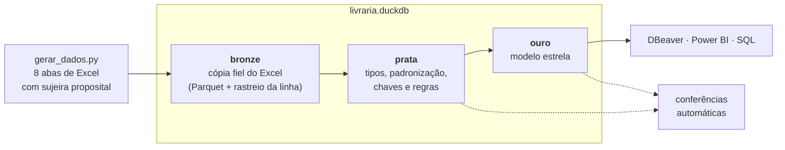
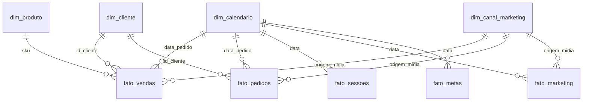

# Livraria Capítulo Um: pipeline de dados de e-commerce com DuckDB

🇧🇷 Português · [🇺🇸 English](README.en.md)

Pipeline completo que transforma planilhas Excel "do mundo real", com dados duplicados,
acentos corrompidos, tipos misturados e colunas que mudam de um ano para o outro, num banco
analítico confiável e num **modelo estrela** pronto para Power BI ou SQL.

> **Todos os dados são fictícios.** A Livraria Capítulo Um não existe: livros, autores,
> editoras, clientes e números são gerados pelo script `gerar_dados.py`. Não há dados
> pessoais; o cliente é só um número. Qualquer semelhança com empresas ou obras reais é
> coincidência.

## Destaques

- **Arquitetura medalhão** (bronze → prata → ouro) em SQL, com DuckDB.
- **Carga incremental pelo conteúdo:** cada Excel tem uma impressão digital (SHA-256); só é
  relido o arquivo que mudou de verdade. Sem mudanças, a carga leva ~3 s.
- **Carga segura:** o banco é montado num arquivo temporário e só substitui o oficial no
  final. Se um `.sql` falhar, o banco anterior continua intacto.
- **27 conferências automáticas** a cada carga, separando o que a prata já tratou do que
  precisa de alguém.
- **Modelo estrela** com 4 dimensões e 5 fatos, e conferência de integridade (toda chave de
  fato existe na sua dimensão).
- **Calendário gerado em SQL:** feriados nacionais (os móveis calculados a partir da
  Páscoa), dias úteis e datas comerciais. Ele se estende sozinho na virada do ano.
- **7 análises de negócio** prontas em [`analises/`](analises): meta, mais vendidos, canais,
  recompra por safra (cohort), funil, sazonalidade, entrega e cancelamento.

## Arquitetura



| Camada | O que guarda | Como |
|---|---|---|
| **bronze** | Cópia fiel de cada aba do Excel + `_linha_excel`, `_arquivo_origem`, `_carregado_em` | `bronze/<tabela>.parquet`; no banco, uma VIEW que lê o Parquet |
| **prata** | Dados tratados e tipados, com `PRIMARY KEY` / `UNIQUE` / `NOT NULL` | Um `sql/prata/<tabela>.sql` por tabela + funções em `_macros.sql` |
| **ouro** | Modelo estrela para análise | Um `sql/ouro/<tabela>.sql` por dimensão/fato |

## Modelo estrela



| Tabela | Uma linha por | Linhas | Destaque |
|---|---|---:|---|
| `fato_vendas` | item de pedido | 312 mil | quantidade, valor bruto, desconto, valor do item |
| `fato_pedidos` | pedido | 215 mil | frete contado **uma vez** (no Excel ele se repete em cada item), prazo de entrega, `primeira_compra` |
| `fato_sessoes` | dia + dispositivo | 4,4 mil | sessões, usuários, pedidos registrados |
| `fato_marketing` | dia + origem/mídia | 12 mil | sessões, transações, receita registrada |
| `fato_metas` | dia | 1,1 mil | metas de receita, pedidos e sessões |
| `dim_calendario` | dia | 1,5 mil | feriados, dias úteis, datas comerciais |
| `dim_produto` | SKU | 2,9 mil | título, autor, editora, categoria, formato |
| `dim_cliente` | cliente | 127 mil | região, primeira e última compra |
| `dim_canal_marketing` | origem/mídia | 12 | canal (origem sem canal aparece como "Sem canal no de-para", em vez de sumir) |

Regra de negócio central: **`venda_valida`** = Entregue, Faturado ou Em transporte
(Cancelado, Devolvido e Aguardando pagamento não contam como receita).

## A sujeira e o tratamento

Os Excel saem do gerador com os problemas que aparecem em exportações reais:

| Problema no Excel | Onde | Tratamento na prata |
|---|---|---|
| Data gravada como texto (`05/03/2023`) e como número (`20230305`) | vendas 2023, sessões | `prata.data()` aceita os três formatos |
| Preço como texto no meio de números (`R$ 49,90`) | vendas 2023 | Bronze grava a coluna como texto; `prata.dinheiro()` converte para `DECIMAL(14,2)` |
| Acentos corrompidos (`Balão`) | vendas 2024 | `prata.corrigir_acentos()`, em SQL puro (57 pares) |
| Dia inteiro colado duas vezes | vendas 2024 | Chave `(pedido, item)`; fica a primeira linha |
| Coluna renomeada (`Forma de Pagamento` → `Pagamento`), colunas novas e extintas | vendas 2023–2025 | Anos empilhados com `UNION ALL BY NAME`; colunas = layout mais novo |
| Status em várias grafias (`ENTREGUE`, `entregue `) | vendas | `prata.frase()` |
| UF por extenso (`São Paulo`) | vendas | `prata.uf()` → `SP` |
| CEP sem o zero à esquerda (`1310100`) | vendas | `prata.cep()` → `01310100` |
| Frete e total do **pedido** repetidos em cada item | vendas | `fato_pedidos` conta uma vez; `fato_vendas` não traz frete |
| Título antes do cabeçalho; SKU repetido (versão atualizada embaixo) | produtos | Linha do cabeçalho configurável; fica a última versão |
| Linha "Total" no fim; dispositivo repetido no mesmo dia | sessões | Total removido; fica a primeira linha |
| Linhas sem origem; origem sem canal no de-para; de-para com linha repetida | marketing | Mantidas e **sinalizadas** nas conferências |
| Dia faltando (29/02/2024) | metas | Sinalizado nas conferências |

## Conferências automáticas

Ao fim de cada carga:

```text
Conferências:
  metas: dia sem meta (entre a primeira e a última meta)                   ATENÇÃO: 1
  marketing: linha sem origem/mídia no Excel                               ATENÇÃO: 6
  marketing: origem/mídia sem canal no de-para (completar a aba DePara)    ATENÇÃO: 1
  ouro: fato_vendas com sku fora da dim_produto                            ok
  ouro: pedido com valor_total diferente de valor_produtos + frete         ok
  produtos: SKU repetido no Excel (fica a linha mais embaixo)              tratado: 12
  sessões: dia + dispositivo repetido no Excel (fica a primeira linha)     tratado: 12
  vendas: pedido + item repetido no Excel (fica a primeira linha)          tratado: 274
  vendas: título com acento corrompido no Excel (corrigido)                tratado: 2,397
  vendas: status escrito fora do padrão no Excel (padronizado)             tratado: 12,499
  vendas: soma de valor_item diferente do Excel                            ok
  ...
```

- **`tratado`**: sujeira conhecida que a prata resolveu sozinha (mostra quanto).
- **`ATENÇÃO`**: precisa de alguém na origem. O banco é atualizado mesmo assim.

## Algumas respostas que o modelo dá

Ano de 2025 (dados fictícios):

| Pergunta | Resposta | Consulta |
|---|---|---|
| A loja bateu a meta? | Não: 87–91% da meta todo mês | [`01`](analises/01_realizado_vs_meta.sql) |
| O que mais vende? | Didáticos (17% da receita), puxados pela volta às aulas | [`02`](analises/02_mais_vendidos.sql) |
| De onde vem a receita? | Mídia paga 32%, orgânico 22,5%; a ferramenta de análise registra só 92% das vendas | [`03`](analises/03_canais_de_marketing.sql) |
| Os clientes voltam? | 23% voltam em até 90 dias e 38% em até 1 ano, estável entre as safras | [`04`](analises/04_recompra_por_safra.sql) |
| Qual dispositivo converte mais? | App 2,6%, desktop 1,9%, mobile 1,0%; o app subiu de 17% para 28% das sessões | [`05`](analises/05_funil_por_dispositivo.sql) |
| Quanto vale a Black Friday? | 4,6× um dia comum; o Dia Nacional do Livro, 2,1× | [`06`](analises/06_datas_comerciais.sql) |
| Onde a operação perde? | Boleto cancela 22% dos pedidos (Pix e cartão, 4,5%); fora do Sul e Sudeste a entrega leva 2 dias a mais | [`07`](analises/07_entrega_e_cancelamento.sql) |

## Decisões técnicas

- **DuckDB:** banco analítico num arquivo só, sem servidor, rápido para milhões de linhas e
  com SQL completo. Abre no DBeaver, no Python e no Power BI (ODBC).
- **Bronze em Parquet:** o Excel é lido uma vez e guardado em formato colunar; o banco
  `.duckdb` fica pequeno.
- **Leitura robusta na prata:** `SELECT COLUMNS(*)::VARCHAR FROM bronze.x` e cada coluna
  convertida por uma função. O tipo final não depende de como o Excel guardou a célula.
- **`DECIMAL(14,2)` para dinheiro:** somas exatas, sem as sobras de casas decimais do `DOUBLE`.
- **Códigos como texto** (SKU, ISBN, CEP, ID do cliente): são identificadores, não números
  para somar, e assim não perdem zeros.
- **Correção de acentos em SQL puro:** a função fica gravada no banco e funciona em qualquer
  consulta, não só durante a carga.
- **Ouro como VIEW sobre a prata:** a prata já é tabela com chave; o ouro não duplica dados.
- **Marcações sim/não como texto** (`Verdadeiro` / `Falso`): leitura mais clara em relatórios
  do que caixas de seleção.

## Como rodar

Requisitos: Python 3.11 ou mais novo.

```bash
pip install -r requirements.txt
python gerar_dados.py      # ~75 s: cria os Excel em dados_origem/
python carregar.py         # ~15 s na primeira vez; depois, só relê o que mudou
```

Para consultar:

- **DBeaver:** nova conexão DuckDB apontando para `livraria.duckdb` (de preferência com a
  propriedade `duckdb.read_only = true`).
- **Python:**
  ```python
  import duckdb
  con = duckdb.connect("livraria.duckdb", read_only=True)
  con.sql("SELECT * FROM ouro.fato_pedidos LIMIT 5").show()
  ```
- `python carregar.py --tudo` relê todos os Excel, mesmo os que não mudaram.

## Estrutura

```text
├── gerar_dados.py          gera os Excel fictícios (com sujeira proposital)
├── config.py               lista das bases: tabela → arquivo, aba, linha do cabeçalho
├── carregar.py             bronze (Excel → Parquet) + prata + ouro + conferências
├── requirements.txt        bibliotecas em versões fixas
├── sql/
│   ├── prata/              _macros.sql (funções de tratamento) + um .sql por tabela
│   ├── ouro/               _macros.sql (regras de negócio) + dimensões e fatos
│   └── conferencias/       cada arquivo devolve (conferencia, quantidade, tipo)
└── analises/               7 consultas de negócio comentadas
```

Pastas geradas (fora do Git): `dados_origem/` (Excel), `bronze/` (Parquet) e `livraria.duckdb`.

## Tecnologias

Python · pandas · DuckDB · SQL · Parquet (pyarrow) · python-calamine · openpyxl · Mermaid

## Autor

**Carlos Pinheiro**, analista de dados · [LinkedIn](https://www.linkedin.com/in/carlospinheiroanalista/)

## Licença

[MIT](LICENSE): pode usar e adaptar o código, mantendo o aviso de autoria.
